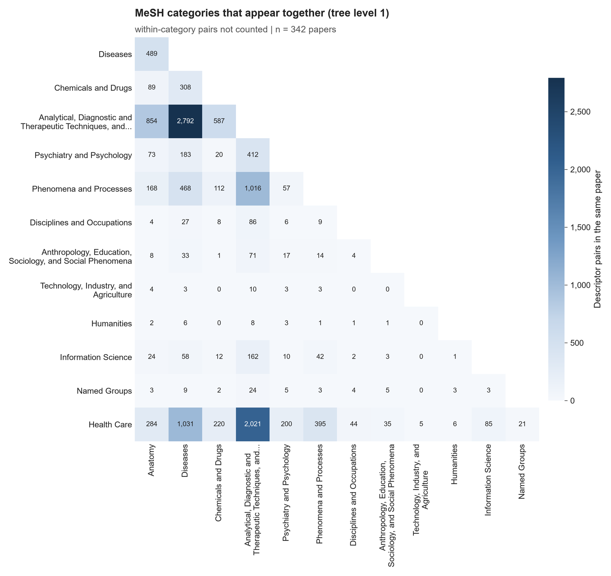
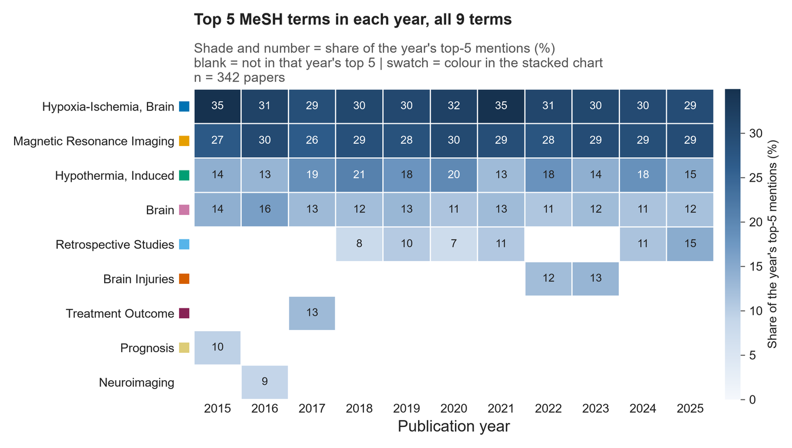
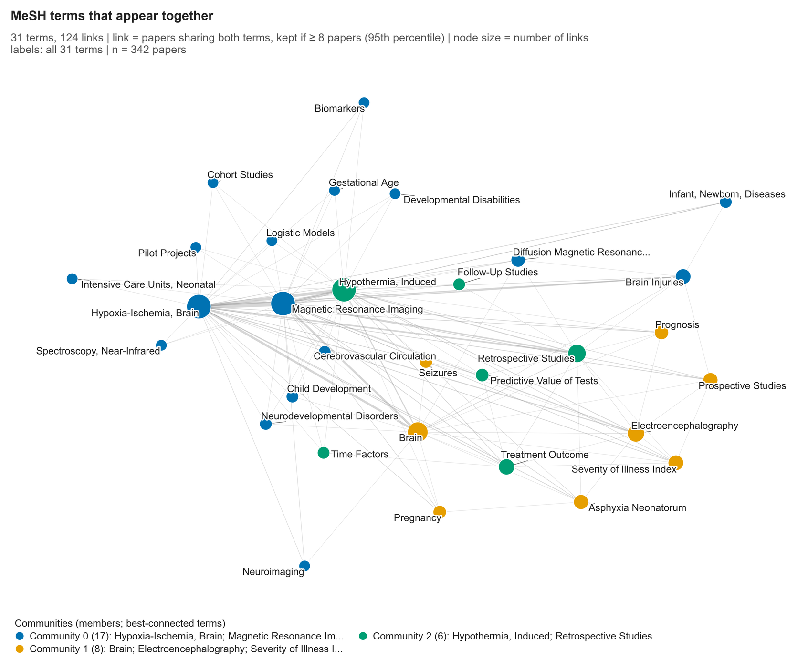

# Meshlytics

[](https://github.com/i3-research/meshlytics/actions/workflows/ci.yml)

[](LICENSE)
[](https://doi.org/10.5281/zenodo.24407062)

**MeSH-hierarchy-aware analysis of PubMed literature.**

Meshlytics is a command-line tool that builds a literature dataset from PubMed and analyses its topics through
the Medical Subject Headings (MeSH) that NLM indexers assign to each paper. Every MeSH descriptor of a paper is
placed at **all** of its positions in the MeSH tree, so topics can be counted, filtered and compared at different
levels of the hierarchy, from broad categories (e.g. *C Diseases*) to narrower branches (e.g. *C04.588 Neoplasms
by Site*), and followed over time.

- **Acquisition** - PubMed metadata (title, DOI, journal, year, authors and affiliations, abstract, publication
  types, MeSH descriptors with their IDs) for a list of PubMed IDs, for all papers citing a set of cohort papers,
  or for the most cited papers of a journal.
- **MeSH hierarchy** - a table of all descriptors in a dataset with counts and every tree path; co-occurrence of
  MeSH categories at tree levels 1, 2 and 3.
- **Filtering** - remove chosen terms or whole MeSH branches (e.g. all *Named Groups*, M) before analysis.
- **Topic trends** - publications per year, top MeSH terms per year, trends of chosen terms, wordclouds per
  time window.
- **Networks** - MeSH term co-occurrence, co-authorship and institution collaboration networks with communities,
  exportable to Gephi.

Meshlytics does not search PubMed itself: you choose the papers (a PubMed search exported as PMIDs, a set of
cohort papers, or a journal), and Meshlytics retrieves and analyses them.

Authors: Ankush Kesri, Stefanie Perrier, P. Ellen Grant, Sarah U. Morton and Yangming Ou, Boston Children's Hospital and
Harvard Medical School (see [Authors](#authors)).

## Contents

- [Installation](#installation)
- [Configuration](#configuration)
- [Quick start](#quick-start)
- [Commands](#commands)
- [Output of `analyze`](#output-of-analyze)
- [MeSH data](#mesh-data)
- [Web services and data sent](#web-services-and-data-sent)
- [Development](#development)
- [Citation](#citation) · [Licence](#licence) · [Support and contributing](#support-and-contributing) · [Authors](#authors)

## Installation

Requires Python 3.10 or newer. Continuous integration tests Python 3.10-3.12 on Windows and Linux.

On Windows, check with `python --version`. If it reports "Python was not found" or opens the Microsoft Store, Python
is not installed: install it from [python.org](https://www.python.org/downloads/windows/) and tick "Add python.exe
to PATH" in the installer. If the Store still opens, switch off the `python.exe` and `python3.exe` entries under
Settings -> Apps -> Advanced app settings -> App execution aliases, then open a new terminal.

```
git clone https://github.com/i3-research/meshlytics.git
cd meshlytics
python -m venv .venv
.venv\Scripts\activate            # Windows   (Linux/macOS: source .venv/bin/activate)
python -m pip install .
meshlytics --version
```

The optional `institution-processing` command also needs the OpenAI client: `python -m pip install ".[llm]"`.

## Configuration

`analyze`, `filter-data` and `mesh-count` work offline and need no configuration. The commands that call web
services read credentials from environment variables, or from a JSON file (environment variables take priority):

| Setting | Environment variable | JSON key | Needed for |
|---|---|---|---|
| Contact email for NCBI E-utilities | `NCBI_EMAIL` | `email` | `fetch`, `top-cited` (required by NCBI) |
| NCBI API key | `NCBI_API_KEY` | `api_key` | optional: raises the PubMed limit from 3 to 10 requests per second |
| OpenAlex API key | `OPENALEX_API_KEY` | `openalex_api_key` | `top-cited` |
| OpenAI API key | `OPENAI_API_KEY` | `open_ai_api_key` | `institution-processing` |
| OpenAI model | `OPENAI_MODEL` | `openai_model` | optional, default `gpt-4o` |

The JSON file is read from `--config <file>`, else the path in `MESHLYTICS_CONFIG`, else `config.json` in the
current folder. Start from [`config.example.json`](config.example.json). `config.json` is listed in `.gitignore`;
never commit or share a file with real keys. An NCBI API key can be created in your NCBI account settings.

```
set NCBI_EMAIL=you@institution.edu        # Windows   (Linux/macOS: export NCBI_EMAIL=you@institution.edu)
meshlytics fetch -f pmids.txt
```

## Quick start

1. **Choose papers.** Run a search on [PubMed](https://pubmed.ncbi.nlm.nih.gov/), then *Save* -> *All results* ->
   format *PMID*, and save the file as `pmids.txt`. The example below used this query (350 papers in November 2026;
   the number grows as PubMed is updated):

   ```
   "Hypoxia-Ischemia, Brain"[Majr] AND "Magnetic Resonance Imaging"[Mesh] AND "Infant, Newborn"[Mesh] AND 2015:2024[dp]
   ```

2. **Fetch the PubMed records** (about 2 minutes without an API key):

   ```
   meshlytics fetch -f pmids.txt
   ```

   This writes `pmids_fetched_data.xlsx` (one row per paper), `mesh_terms_with_keys_and_counts.xlsx` (every MeSH
   term with its count and tree paths), `pmids_skipped_pmids.txt` and `pmids_fetch_log.txt`.

3. **Optional: remove terms.** Mark terms with `Y` in the `filter_out_term?` column of
   `mesh_terms_with_keys_and_counts.xlsx`, and/or name whole MeSH branches to drop:

   ```
   meshlytics filter-data -f pmids_fetched_data.xlsx --exclude-categories B M Z --special-terms Male Female
   ```

   This writes `pmids_fetched_data_filtered.xlsx`.

4. **Analyse:**

   ```
   meshlytics analyze -f pmids_fetched_data_filtered.xlsx -hg -co -wc -mesh-tl -mesh-stacked -mesh-gn -journals -authors -authors-gn
   ```

   Results are written to a new folder `Analysis_pmids_filtered_<date>_<time>` beside the data file.

### Example output

From the quick-start run above (342 papers after screening; MeSH branches B, M and Z and the check tags Male and
Female removed with `filter-data`).

**MeSH categories that appear together** (`-co`, tree level 1): how often descriptors from two top-level MeSH
categories are indexed on the same paper. Every tree position of a descriptor counts, so a term that sits in several
branches (here, some Named Groups terms also indexed elsewhere) still links those branches.



**Top MeSH terms per year** (`-mesh-stacked`): each year's five most frequent terms and their share of that year's
top-5 mentions.



**MeSH term network** (`-mesh-gn`): terms linked when they are indexed on the same papers, coloured by community.



## Commands

```
meshlytics --help
meshlytics <command> --help
```

| Command | Stage | What it does |
|---|---|---|
| `fetch` | acquisition | PubMed records for a PMID list (`.txt`) or for the papers citing cohort papers (`.xlsx`) |
| `top-cited` | acquisition | Dataset of the N most cited papers of a PubMed-indexed journal |
| `mesh-count` | MeSH hierarchy | MeSH term table with counts and all tree paths (also made by `fetch`) |
| `filter-data` | filtering | Remove marked terms, whole MeSH branches or named terms |
| `institution-processing` | filtering (optional) | Standardised short institution names with an OpenAI model |
| `analyze` | MeSH analysis, visualisation | Figures and tables (see below) |

For `analyze`, `filter-data`, `mesh-count` and `institution-processing`, `-f` takes a path or just a file name
(with or without `.xlsx`); a name is searched in the current folder and its subfolders, and the file used is
printed. Every command writes its results beside the file it reads.

### `fetch`

- **PMID list** (`-f list.txt`): one PubMed ID per line; a header line is skipped and duplicates are removed.
  Output: `list_fetched_data.xlsx`.
- **Cohort workbook** (`-f cohorts.xlsx`): the first sheet has one row per cohort - a short cohort name (used as
  sheet name) followed by the PMIDs of that cohort's own papers, one per column (an optional first column named
  `cohort name` is ignored). For every cohort paper, the papers citing it are found in PubMed and written to a new
  sheet per cohort, with the cohort paper they cite (`associated_cohort_paper_id`). A citing paper is stored once,
  under the first cohort that returns it. Paper counts per cohort are added to the first sheet.
- **Screening** by PubMed publication type: editorials, comments, letters, news, errata, retractions, duplicate
  publications and similar non-original records are skipped and listed in `*_skipped_pmids.txt`. Reviews are kept
  and marked (`review_paper` = Yes); `analyze --exclude-review-papers` leaves them out.
- Papers that are not yet indexed have no MeSH terms; they are kept and listed. `--mesh-on-demand`
  (experimental, off by default) requests suggested terms for them from NLM's MeSH on Demand (30-60 s per paper).
- Every request is logged with a timestamp in `*_fetch_log.txt`; a summary is printed at the end.

### `top-cited`

```
meshlytics top-cited -j "Nat Neurosci" -n 100 --year-range 2016 2025
meshlytics top-cited --issn 0140-6736 -n 50 -y
```

The journal is matched against the NLM journal list (spelling errors tolerated; ISSN accepted) and confirmed
interactively. Papers are ranked by OpenAlex citation count; PubMed records are screened as in `fetch` (reviews
excluded unless `--include-reviews`; the journal is checked by NLM ID), and excluded papers are replaced by the
next most cited ones until N papers remain. PubMed cited-in counts are added for comparison. Output: a folder
`TopCited_<journal>_<from>_<to>_Top<N>_<date>` with the dataset for `analyze`, the full ranking with exclusion
reasons, and a run summary. OpenAlex counts change over time; the run date is saved.

To analyse another ranking (for example a journal's "most downloaded" list), put the PMIDs in a text file and use
`fetch`: download counts are not openly available across journals, and Meshlytics does not scrape websites.

### `mesh-count` and `filter-data`

`mesh-count -f data.xlsx` writes `mesh_terms_with_keys_and_counts.xlsx`: every MeSH term with its MeSH ID, count
(reviews and non-original papers excluded), all tree paths (` | ` separated), the number of tree positions, and a
`filter_out_term?` column. A file in which you have marked terms is never overwritten; new counts get a dated name.

`filter-data -f data.xlsx` removes from the `mesh_terms` column:

- terms marked `Y` (or yes / 1 / true) in `filter_out_term?` of the keyword file beside the data file (or `-k`);
- terms in the MeSH branches given with `--exclude-categories` (e.g. `B M Z`, or level-2 codes such as `C04`).
  Many terms sit in several branches (e.g. *Parents*: F01, I01 and M01). By default (`--category-match all`) a term
  is removed only if all its paths are in excluded branches; `--category-match any` removes it if any path is;
- terms named with `--special-terms`.

### `institution-processing`

Optional. Sends each unique first affiliation of every author to an OpenAI model and stores a standardised full
name and a short name (e.g. *Erasmus MC, Rotterdam* -> *Erasmus U*). Output: `<name>_with_llm_standard_institution_names.xlsx`
with a new `author_institution_llm` column, and a mapping table to review. `analyze -institutions`,
`-institutions-gn` and `--include-institution-name` use this column. Results depend on the model; check the
mapping table before using the names.

### `analyze`

| Option | Output |
|---|---|
| `-hg` | Publications per year; with `--use-entropy-window` also the most evenly spread window of years |
| `-wc`, `--longitudinal-wordcloud` | Wordcloud of MeSH terms; one per time window |
| `-mesh-tl`, `--top-trend N`, `--trend-mode` | Yearly counts of the top N terms |
| `-mesh-ng TERM ...`, `--ngfile`, `--ngnorm` | Yearly counts of chosen terms |
| `-mesh-stacked`, `--top-stacked N` | Share of each year's top-N terms, stacked chart and heatmap |
| `-co` | Co-occurrence of MeSH categories at tree levels 1-3 |
| `-mesh-gn`, `-authors-gn`, `-institutions-gn` | MeSH term, co-author and institution networks |
| `-journals`, `-authors`, `-institutions` | Top journals, authors and first-author institutions |
| `--year-range FROM TO`, `--exclude-current-year`, `--exclude-review-papers`, `-c COHORT ...` | Which papers are analysed |
| `--fig-dpi`, `--fig-format png pdf svg`, `--font-scale`, `--network-labels` | Figure settings |

`meshlytics analyze --help` lists all options. [docs/FIGURES.md](docs/FIGURES.md) describes every figure, the
shared style and the network rules.

## Output of `analyze`

Each run creates a new folder `Analysis_<data name>_<date>_<time>` beside the data file, so runs never overwrite
each other. Depending on the options it contains:

| Files | Content |
|---|---|
| `analysis_summary.txt` | Run date and time, papers loaded and excluded at each step, options, MeSH dictionary used, outputs made |
| `full_histogram.png`, `histogram_<from>_<to>.png`, `entropy_trends_by_year_window.png` | Publications per year |
| `Wordcloud_*.png` | Wordclouds |
| `top_<N>_MeSH_terms_trend_*.png`, `custom_MeSH_terms_trend_*.png` | Term trends |
| `stacked_top<N>_terms_relative_sorted_per_year.png`, `top<N>_terms_per_year_heatmap.png`, `stacked_top<N>_terms_relative_per_year.xlsx` | Top terms per year |
| `level1/2/3_co_occurrence_matrix.csv`, `level1/2_cooccurrence_heatmap.png`, `UID_MeSH_term_path_with_levels.csv` | MeSH category co-occurrence |
| `MeSHGraph_*`, `AuthorGraph_*`, `InstitutionGraph_*` (`.png`, communities, edges, Gephi `.csv`), `MeSH_Pairs.xlsx`, `*_Collaboration_Pairs.xlsx`, `Top_<N>_MeSH_terms_cooccurrence_matrix.xlsx` | Networks |
| `Top_<N>_*.png`, `Journal_Counts_All.xlsx`, `Author_Counts_*.xlsx`, `Institution_Counts_All.xlsx` | Top journals, authors, institutions |

With the same installation, the same data and options give the same tables and figures on every run, including
network layouts and communities.

## MeSH data

Meshlytics ships MeSH 2026, converted from the NLM descriptor file `desc2026.xml` with
[`scripts/build_mesh_dictionary.py`](scripts/build_mesh_dictionary.py), and the NLM list of PubMed journals.
[src/meshlytics/essentials/README.md](src/meshlytics/essentials/README.md) records the source files, download dates,
checksums and how to rebuild the data for a newer MeSH year.

MeSH and the PubMed journal list are produced by the U.S. National Library of Medicine (NLM). Meshlytics is not
affiliated with or endorsed by NLM. The MeSH data in this repository are a converted subset (descriptor names,
IDs and tree numbers); the original files are available from NLM.

## Web services and data sent

| Service | Used by | Data sent |
|---|---|---|
| NCBI E-utilities (PubMed) | `fetch`, `top-cited` | PMIDs; your contact email, the tool name `meshlytics` and your API key, as NCBI requires. Requests are limited to 3 per second (10 with an API key) |
| OpenAlex | `top-cited` | Journal identifier and year range; your OpenAlex key |
| OpenAI | `institution-processing` only | Author affiliation strings |
| NLM MeSH on Demand | `fetch --mesh-on-demand` / `top-cited --mesh-on-demand` only (experimental) | Abstracts of papers without MeSH terms; your contact email in the request header |

For large `fetch` runs, NCBI asks users to run them on weekends or between 9 pm and 5 am US Eastern time.

## Development

```
python -m pip install -e ".[dev,llm]"
python -m pytest            # offline: web services are replaced by fakes
ruff check .
```

Continuous integration runs the tests on Ubuntu and Windows with Python 3.10-3.12, a run with the oldest supported
dependency versions, and the linter. Changes are listed in [CHANGELOG.md](CHANGELOG.md).

## Citation

If you use Meshlytics, please cite the version you used. For version 1.0.0:

> Kesri A, Perrier S, Grant PE, Morton SU, Ou Y. Meshlytics: MeSH-hierarchy-aware analysis of PubMed literature.
> Version 1.0.0. Zenodo; 2026. https://doi.org/10.5281/zenodo.24407063

Each release is archived on Zenodo. To cite all versions, use the concept DOI
[10.5281/zenodo.24407062](https://doi.org/10.5281/zenodo.24407062), which always resolves to the latest release.
The same information is in [CITATION.cff](CITATION.cff) (GitHub shows a "Cite this repository" button).

## Licence

Meshlytics is source-available under the [PolyForm Noncommercial License 1.0.0](LICENSE). You may use, copy and
modify it for any noncommercial purpose, including research, teaching and personal use, and it may be used by
universities, hospitals, public research organisations, charities and government bodies. Commercial use needs a
separate licence; please contact the maintainer. Because commercial use is not permitted, this is not an
OSI-approved open-source licence.

The MeSH data shipped in `src/meshlytics/essentials/` come from the U.S. National Library of Medicine and are not
covered by this licence (see [MeSH data](#mesh-data)).

## Support and contributing

Questions, bug reports and feature requests: please open an
[issue](https://github.com/i3-research/meshlytics/issues). Contributions are welcome; see
[CONTRIBUTING.md](CONTRIBUTING.md) and the [code of conduct](CODE_OF_CONDUCT.md).
A security policy, including how to report a problem privately, is in [SECURITY.md](SECURITY.md).

## Authors

Boston Children's Hospital and Harvard Medical School:

- **Ankush Kesri** ([ORCID 0009-0003-4814-074X](https://orcid.org/0009-0003-4814-074X)) - developer and maintainer
- **Stefanie Perrier**
- **P. Ellen Grant**
- **Sarah U. Morton**
- **Yangming Ou** - senior author; designed the original workflow of reading cohort papers from an Excel workbook,
  fetching the papers that cite each cohort paper, and storing them as one sheet per cohort, which Ankush Kesri
  implemented.
